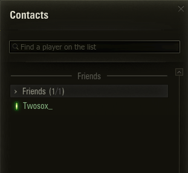
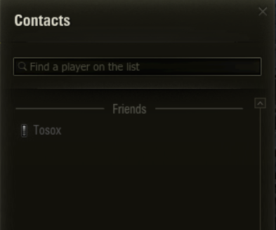
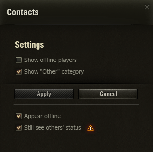

# Appear Offline

[)](https://github.com/Tosox/wot-appear-offline/releases) [)](https://github.com/Tosox/wot-appear-offline/releases/latest)

## 📜 Description

Makes your account appear offline to friends and clanmates in the World of
Tanks client while you keep playing normally, optionally without losing your
own view of their online status. Everything is configured from a native panel
inside the game's Contacts window.

For friends there are two modes:

* **Invisible** (*"Still see friends' status" on*): you appear offline to them,
  but you still see their live status. *Caveat:* friends see you briefly come
  online right after you log in, before you disappear again.
* **Hard offline** (*"Still see friends' status" off*): you go fully offline to
  the server. Simplest and flicker-free, but you also stop seeing their status.

Clanmates are hidden by leaving clan chat, so by default you no longer receive
clan messages and clanmates show as offline to you. Tick **"Still appear online
to clanmates"** to keep clan chat which makes clanmates and any friend in your
clan see you as online.

> [!NOTE]
> Your own row in the clan list and contacts always shows you as online.
> That's your client's view of itself, not what your clanmates see.

## 🎮 Usage

Open `Contacts → Settings` in the garage. There you'll find three checkboxes:

* **Appear offline** — master switch for the mod, covering friends and clanmates.
* **Still see friends' status** — picks Invisible (on) vs Hard offline (off) for
  friends. Hover its ⚠ icon for details.
* **Still appear online to clanmates** — carves clanmates out of the master
  switch to keep clan chat. Hover its ⚠ icon for details.

> [!NOTE]
> A change takes effect on your **next login**, not instantly

## 🔧 Installation

* Download the [latest release](https://github.com/Tosox/wot-appear-offline/releases/latest)
* Drop the `.wotmod` into your game's mods folder: `World_of_Tanks_EU\mods\<version>\`
* Launch the game and configure it from **Contacts → Settings**

## 📝 Changelog

You can check out the latest changes in [`CHANGELOG.md`](CHANGELOG.md).

## 🎥 Preview

<table>
  <tr>
    <th align="left">Your view</th>
    <th align="left">Their view</th>
  </tr>
  <tr>
    <td align="left"></td>
    <td align="left"></td>
  </tr>
  <tr>
    <td colspan="2" align="left"></td>
  </tr>
</table>

## 🛠️ Build from source

### Prerequisites

* [Python 2.7.18](https://www.python.org/downloads/release/python-2718/) — compiles the game bytecode
* A JDK such as [Eclipse Temurin 11](https://adoptium.net/temurin/releases/?version=11) — required by the Flex compiler
* [Apache Flex SDK 4.16.1](https://archive.apache.org/dist/flex/4.16.1/binaries/apache-flex-sdk-4.16.1-bin.zip) — compiles the UI SWF
* Adobe [`playerglobal32_0.swc`](https://fpdownload.macromedia.com/get/flashplayer/updaters/32/playerglobal32_0.swc) — not bundled with Flex, so it's a separate download

### Setup

1. Extract the Flex SDK somewhere, then drop `playerglobal32_0.swc` into it as
   `frameworks/libs/player/11.1/playerglobal.swc`.
2. Point the `FLEX_HOME` environment variable at that SDK folder.
3. Point the `PYTHON27` environment variable at your Python 2.7 executable
   (e.g. `C:\Python27\python.exe`). Skip this if you run `build.py` with Python 2.7 directly.
4. For `--install`, copy `build.local.example.json` to `build.local.json` and fill
   in your `game_dir` and `game_version`.

### Build

```bash
python build.py            # -> dist/<id>_<version>.wotmod
python build.py --install  # also copies it into the game's mods/<version> folder
```

The mod is configured through `mod.json`.

## 📄 License

Distributed under the GNU General Public License v3.0. See [`LICENSE`](LICENSE) for more information.
